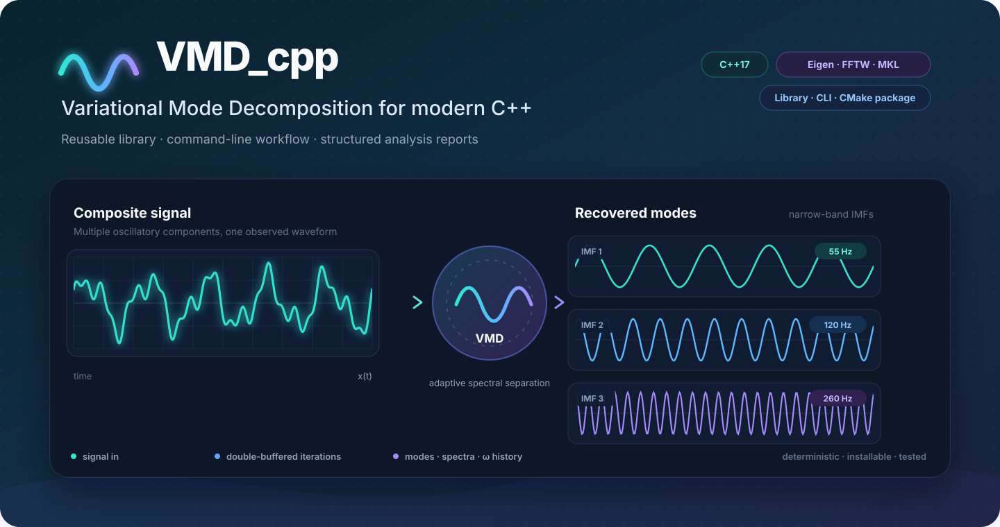

# VMD_cpp

<p align="center">
  
</p>

VMD_cpp is a C++17 implementation of Variational Mode Decomposition (VMD). The
project provides a reusable Eigen-based library, a compatibility wrapper for the
original API, a command-line tool, structured CSV/JSON output, and a fully
self-contained HTML report.

## Highlights

- Corrected `N x K` mode spectra: each column is `fftshift(fft(IMF))`.
- Stable handling of zero, constant, short, odd-length, and even-length signals.
- Per-mode `alpha`, reproducible random initialization, warm starts, and optional adaptive `tau`.
- Double-buffered iterations with `O(K * N)` working memory instead of storing every iteration.
- CSV/TSV CLI input and CSV, JSON, and offline HTML/SVG output.
- Installable CMake package exported as `VMD_cpp::vmd`.
- Eigen FFT by default, with optional FFTW and MKL backends.

## Requirements

- CMake 3.20 or newer
- A C++17 compiler
- Eigen 3.3 or newer

CMake first searches for `Eigen3::Eigen`. If it is unavailable, Eigen 3.4.0 is
fetched automatically. The bundled historical `Eigen/` tree is ignored unless
`VMD_USE_VENDORED_EIGEN=ON` is explicitly selected.

## Build

```sh
cmake -S . -B build -DCMAKE_BUILD_TYPE=Release
cmake --build build --config Release --parallel
ctest --test-dir build -C Release --output-on-failure
```

Useful options:

| Option | Default | Purpose |
|---|---:|---|
| `VMD_BUILD_CLI` | `ON` | Build `vmd_cli`. |
| `VMD_BUILD_EXAMPLES` | `ON` | Build `vmd_example`. |
| `VMD_BUILD_TESTS` | `BUILD_TESTING` | Build unit and CLI tests. |
| `VMD_BUILD_BENCHMARKS` | `ON` | Build `vmd_benchmark`. |
| `VMD_BUILD_DOCS` | `ON` | Add a `docs` target when Doxygen exists. |
| `VMD_FFT_BACKEND` | `Eigen` | Select `Eigen`, `FFTW`, or `MKL`. |
| `VMD_ENABLE_SANITIZERS` | `OFF` | Enable ASan and UBSan on supported compilers. |

## Library API

```cpp
#include <vmd/vmd.hpp>

Eigen::VectorXd signal = /* finite samples */;

vmd::Options options;
options.mode_count = 6;
options.alpha = {2000.0};        // broadcast to all modes
options.sample_rate_hz = 1000.0;
options.initialization = vmd::Initialization::Uniform;

vmd::Result result = vmd::decompose(signal, options);

// result.modes:             K x N
// result.spectra:           N x K, fftshift(fft(mode))
// result.omega_normalized:  iterations x K, cycles/sample
// result.omega_hz:          iterations x K, hertz
```

Invalid arguments throw `std::invalid_argument`. Every returned matrix owns its
storage. Calls do not share decomposition state, so independent calls may run in
parallel.

See [API documentation](docs/api.md) and [algorithm notes](docs/algorithm.md).

## CLI Quick Start

```sh
vmd_cli --input signal.csv --column value --sample-rate 1000 \
        --modes 6 --alpha 2000 --output-dir results --report
```

Read TSV automatically, select a zero-based column index, or read from standard
input with `--input -`. The built-in example is explicit:

```sh
vmd_cli --demo --sample-rate 1200 --modes 8 --alpha 50 \
        --output-dir results --report
```

With no input, the CLI prints help and exits with code 2. A nonconverged run exits
with code 4 but still writes its result files.

## Output Files

- `modes.csv`: index, time, input, every IMF, reconstruction, and residual.
- `spectra.csv`: shifted frequency and real, imaginary, and magnitude values.
- `omega.csv`: center-frequency trajectory in hertz.
- `summary.json`: input metadata, options, diagnostics, timings, and file names.
- `report.html`: optional offline report with inline CSS, JavaScript, data, and SVG.

The report includes input/reconstruction, residual, IMF, spectrum, and frequency
convergence views. Plot data is min/max-envelope downsampled; CSV output retains
all samples.

See [CLI and file formats](docs/cli-and-formats.md).

## Legacy Compatibility

Existing code may continue to include `VMD.h` and call the global `VMD(...)`
function. The wrapper maps old arguments to `vmd::decompose` while preserving:

- `u` as `K x N`.
- `u_hat` as `N x K` (now corrected to the documented spectrum).
- `omega` as normalized cycles per sample.
- Initialization values `0 = zero`, `1 = uniform`, and `2 = random`.

New integrations should use the namespaced API.

## Install and Consume

```sh
cmake --install build --prefix install
```

Downstream CMake:

```cmake
find_package(VMD_cpp 2 CONFIG REQUIRED)
add_executable(my_app main.cpp)
target_link_libraries(my_app PRIVATE VMD_cpp::vmd)
```

Ensure Eigen is discoverable by the downstream project. Packages built with FFTW
or MKL also require the selected backend at link and runtime.

## Validation and Performance

`vmd_tests` covers reference, single-frequency, multifrequency, noisy, chirp,
DC, zero, constant, short, odd/even length, random-seed, warm-start, and legacy
paths. `vmd_benchmark` reports stage timings and an estimated core workspace.

See [validation and performance](docs/validation-and-performance.md).

## License

This project is distributed under the Mozilla Public License 2.0. See
[LICENSE.txt](LICENSE.txt).
